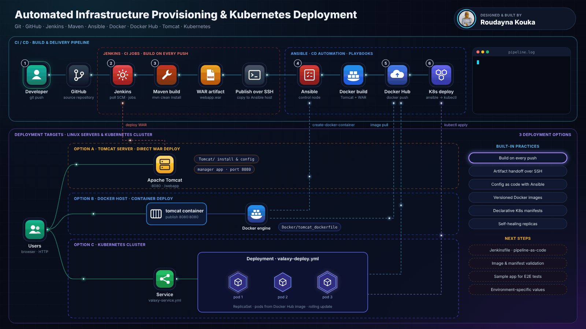

# Automated Infrastructure Provisioning & Kubernetes Deployment


A hands-on DevOps project that takes a Java web application **from a `git push` to a running deployment**. The CI/CD workflow uses **Jenkins, Maven, Ansible, Docker, Tomcat and Kubernetes**, and the same artifact can be shipped to three targets: a Tomcat server, a Docker host, or a Kubernetes cluster.

The repository is organised as implementation notes, Jenkins job definitions, Ansible playbooks, Dockerfiles and Kubernetes manifests. You can reuse it as a starting point for labs, coursework or personal practice.

---

## Table of Contents

- [Architecture](#architecture)
- [How It Works](#how-it-works)
- [Tech Stack](#tech-stack)
- [Repository Structure](#repository-structure)
- [Important Files](#important-files)
- [Getting Started](#getting-started)
- [Deployment Options](#deployment-options)
- [Notes](#notes)
- [Roadmap](#roadmap)
- [Author](#author)
- [License](#license)

---

## Architecture



---

## How It Works

| # | Stage | Tool | What happens |
|---|---|---|---|
| 1 | Commit | Git / GitHub | The developer pushes code to the GitHub repository |
| 2 | Trigger | Jenkins | A Jenkins job detects the change (Poll SCM or webhook) |
| 3 | Build | Maven | `mvn clean install` compiles, tests and packages `webapp.war` |
| — | Hand-off | Publish over SSH | Jenkins copies the WAR (and Dockerfile) to the Ansible control node |
| 4 | Automate | Ansible | Playbooks run on the control node and target the deployment hosts |
| — | Image | Docker | The image is built from a Tomcat base image with the WAR baked in |
| 5 | Registry | Docker Hub | The image is tagged and pushed to Docker Hub |
| 6 | Deploy | Kubernetes | Ansible applies the Deployment and Service manifests with `kubectl` |

Users reach the application over HTTP through Tomcat (port `8080`), the Docker container (`8080:8080`), or the Kubernetes **Service**, depending on the deployment option you choose.

---

## Tech Stack

| Area | Tool | Role in the project |
|---|---|---|
| Source control | Git, GitHub | Versioning and pipeline trigger |
| Continuous Integration | Jenkins | Job orchestration, plugin integrations (Maven, Publish over SSH, Ansible) |
| Build | Maven | Compiles and packages the Java web app as a `.war` |
| Configuration management | Ansible | Automates image build/push and deployment across servers |
| Containerization | Docker, Docker Hub | Tomcat-based application image and image registry |
| Application server | Apache Tomcat | Hosts the WAR (classic deployment and image base) |
| Orchestration | Kubernetes | Deployment (replicas, rolling updates) + Service exposure |

---

## Repository Structure

```text
.
├── Ansible/        # Ansible installation and setup notes
├── Docker/         # Docker commands, installation, Docker Hub usage, Dockerfile examples
├── Jenkins/        # Jenkins installation, plugin setup, Maven setup, Ansible integration
├── Jenkins_Jobs/   # Sample Jenkins job documentation and automation files
├── Kubernetes/     # Kubernetes deployment, service and cluster setup examples
├── Tomcat/         # Tomcat installation and configuration guidance
└── docs/
    └── architecture.gif
```

---

## Important Files

| File | Purpose |
|---|---|
| `Jenkins_Jobs/create-docker-image.yml` | Builds the Docker image of the application |
| `Jenkins_Jobs/create-docker-container.yml` | Runs the application container on the Docker host |
| `Kubernetes/create-simple-devops-image.yml` | Builds, tags and pushes the image to Docker Hub |
| `Kubernetes/valaxy-deploy.yml` | Kubernetes **Deployment** manifest (pods, replicas, image) |
| `Kubernetes/valaxy-service.yml` | Kubernetes **Service** manifest (exposes the pods) |
| `Docker/tomcat_dockerfile` | Basic Tomcat Dockerfile used to package the WAR |

---

## Getting Started

Follow the folders roughly in this order. Each one contains the installation and configuration notes for its tool.

1. **Jenkins**: install Jenkins and Java, then add the Maven, Git, *Publish over SSH* and Ansible integrations → `Jenkins/`
2. **Source**: connect a Jenkins job to your GitHub repository (Poll SCM or webhook).
3. **Build**: configure Maven in Jenkins and package the application (`mvn clean install`).
4. **Tomcat** *(option A)*: install Tomcat and deploy the WAR directly → `Tomcat/`
5. **Ansible**: set up the control node and SSH access to the target hosts → `Ansible/`
6. **Docker** *(option B)*: install Docker, build the Tomcat image and run the container → `Docker/`, `Jenkins_Jobs/`
7. **Kubernetes** *(option C)*: set up the cluster, push the image to Docker Hub and apply the manifests → `Kubernetes/`

Quick commands for the Kubernetes path:

```bash
# Build & push the image (via Ansible)
ansible-playbook Kubernetes/create-simple-devops-image.yml

# Deploy to the cluster
kubectl apply -f Kubernetes/valaxy-deploy.yml
kubectl apply -f Kubernetes/valaxy-service.yml

# Verify
kubectl get deployments,pods,svc
```

---

## Deployment Options

| Option | Target | How the app is delivered | Best for |
|---|---|---|---|
| **A** | Tomcat server | WAR deployed directly by Jenkins | Understanding the classic Java deployment model |
| **B** | Docker host | Ansible runs a container from the Tomcat image (`8080:8080`) | Learning image builds and immutable deployments |
| **C** | Kubernetes cluster | Ansible applies the Deployment + Service manifests | Scaling, self-healing and rolling updates |

---

## Notes

- This repository is mainly **documentation-driven** and intended for learning and demonstration.
- Some files contain example hostnames, usernames, repository URLs and image names. **Adjust them to your own environment** before use.
- The Kubernetes and Ansible object names (for example the `valaxy-*` manifests) were **left unchanged** so the existing examples keep working.
- Never commit real credentials: use Jenkins credentials, Ansible Vault and Kubernetes Secrets for passwords, tokens and Docker Hub logins.

---

## Roadmap

- [ ] Replace placeholder infrastructure values with environment-specific values
- [ ] Add a `Jenkinsfile` for pipeline-as-code
- [ ] Add a sample application source directory for end-to-end testing
- [ ] Add validation steps for Docker and Kubernetes deployments (image scan, `kubectl rollout status`, smoke tests)
- [ ] Tag images with the build number instead of `latest` for traceable rollbacks

---

## Author

**Roudayna Kouka**: Software Engineering student (FST), specialising in Cloud, DevOps & DevSecOps
GitHub: [@roudayn-kouka](https://github.com/roudayn-kouka)

---

## License

Use this repository for learning, practice and customization in your own environment.